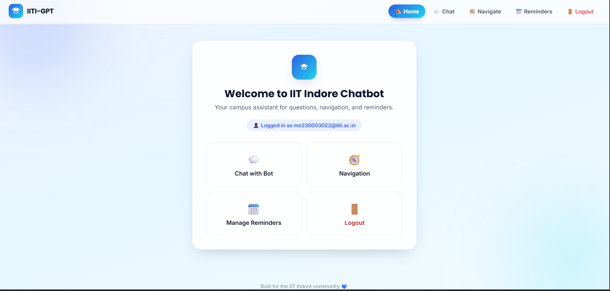
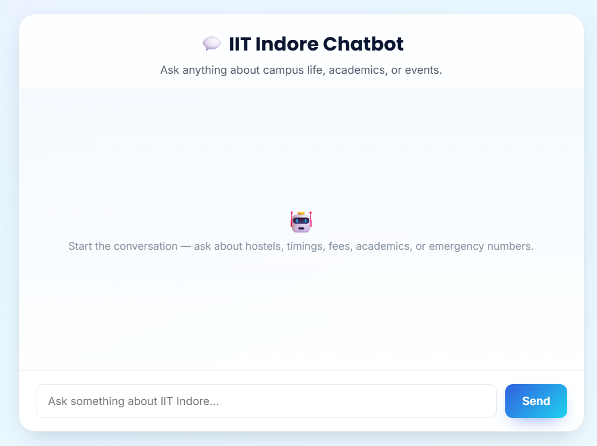
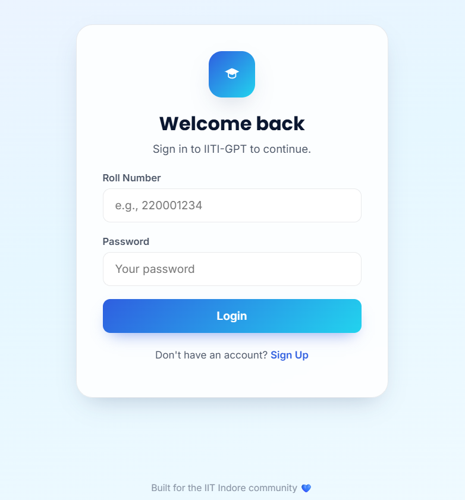
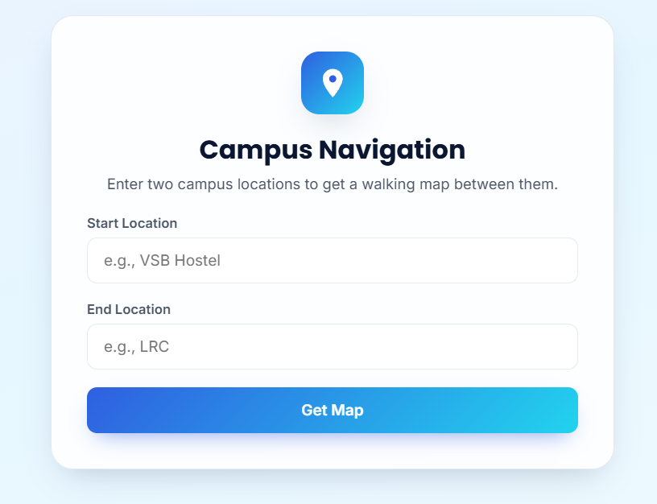
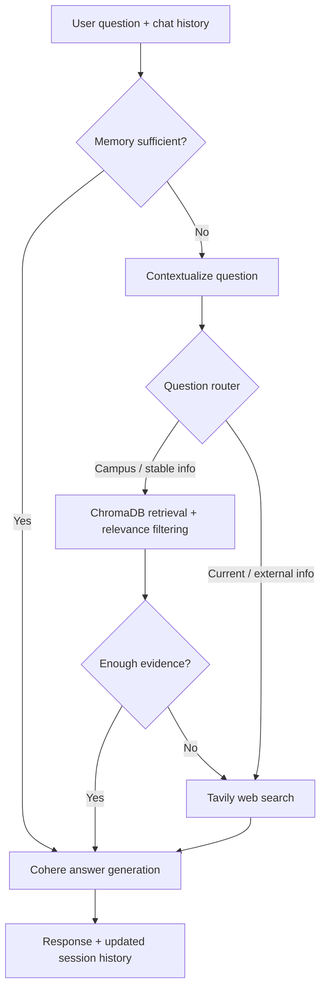

# 🎓 IITI-GPT — AI Campus Assistant for IIT Indore

**A Django-powered campus companion that combines conversational memory, retrieval-augmented generation (RAG), and live web search to answer IIT Indore-related questions.**

IITI-GPT also brings campus navigation and personal reminders into one web application. Its LangGraph workflow selects an appropriate information source for each question, checks retrieved context, and generates a response using Cohere's language model.

**Tech stack:** `Python` · `Django` · `LangGraph` · `LangChain` · `Cohere` · `ChromaDB` · `Sentence Transformers` · `Tavily` · `Folium` · `SQLite` · `HTML/CSS/JavaScript`

## ✨ Key Features

| Feature | What it does |
| --- | --- |
| 💬 **Context-aware chatbot** | Remembers recent messages in a session and handles follow-up questions. |
| 📚 **Campus knowledge retrieval** | Searches a local ChromaDB collection for IIT Indore information using semantic embeddings. |
| 🌐 **Live web search** | Uses Tavily for time-sensitive questions and when local context cannot answer a query. |
| 🧠 **Intelligent query routing** | Uses an LLM-driven LangGraph workflow to choose memory, local retrieval, or web search. |
| 🗺️ **Campus navigation** | Matches campus locations with fuzzy search and displays start/end markers on a Folium map. |
| ⏰ **Personal reminders** | Lets users create and remove reminders, with browser notifications while the reminder page is open. |
| 👤 **Session-based accounts** | Provides a roll-number sign-up/login flow for the prototype. |

## 📸 Project Demo





### 1. Campus information — cafés and food options

The chatbot responds to campus-specific questions using relevant retrieved information.


### 2. Backend execution — terminal logs

These two terminal screenshots show the decision-making workflow executing behind the chat interface.

**Terminal 1 — Conversation-memory check, local vector retrieval, and response generation**


**Terminal 2 — Routing to Tavily web search for information requiring external retrieval**


## 🏗️ How the Chatbot Works



1. **Check conversation memory:** Determine whether previous user messages already contain the answer.
2. **Resolve follow-ups:** Rewrite context-dependent questions into standalone ones when necessary.
3. **Choose a source:** Route relatively stable campus queries to ChromaDB and current/external queries to Tavily.
4. **Validate retrieved evidence:** Filter vector results by relevance and check whether the remaining context can answer the question. If not, fall back to web search.
5. **Generate the answer:** Cohere's `command-a-03-2025` model produces the response, and the app retains up to ten recent session messages.

### RAG configuration

| Component | Implementation |
| --- | --- |
| Vector store | ChromaDB persistent collection: `iit_indore` |
| Embedding model | `BAAI/bge-small-en-v1.5` |
| Top-k retrieval | 5 chunks |
| Relevance filtering | Cosine-distance threshold of `0.4` in the current code |
| Generation model | Cohere `command-a-03-2025` |
| Web retrieval | Tavily Search API |
| Workflow orchestration | LangGraph state graph |

## 🚀 Run Locally

### Prerequisites

- Python and `pip` installed
- A [Cohere API key](https://dashboard.cohere.com/api-keys)
- A [Tavily API key](https://app.tavily.com/)
- An initialized local ChromaDB knowledge base for the RAG path (see the note below)

### 1. Clone the repository

```bash
git clone https://github.com/Monik17/IITI-GPT.git
cd IITI-GPT
```

### 2. Create a virtual environment

```bash
python -m venv venv
```

Activate it:

```bash
# Windows PowerShell
venv\Scripts\Activate.ps1

# macOS / Linux
source venv/bin/activate
```

### 3. Install dependencies

```bash
pip install -r requirements.txt
```

### 4. Configure API keys

Create a `.env` file in the repository root:

```env
COHERE_API_KEY=your_cohere_api_key
TAVILY_API_KEY=your_tavily_api_key
SECRET_KEY=replace_with_a_long_random_django_secret
DEBUG=True
```

Never commit your `.env` file or real API keys to GitHub.

### 5. Apply database migrations

```bash
python manage.py migrate
```

### 6. Start the development server

```bash
python manage.py runserver
```

Open **http://127.0.0.1:8000/**, create a demo account, and navigate to the chatbot, campus map, or reminders.

> **Knowledge-base requirement:** The repository does **not** include the populated `chroma_db/` directory or the crawler / vector-store building scripts referenced by `chatbot/rag.py`. To reproduce the local RAG responses, you must separately build or supply a ChromaDB collection named `iit_indore` using the same embedding model. Cloning the repository and adding API keys alone will not reproduce the complete RAG demo.

## 📁 Repository Structure

```text
IITI-GPT/
├── chatbot/
│   ├── rag.py                  # ChromaDB retrieval and context preparation
│   ├── utils.py                # LangGraph workflow and LLM calls
│   ├── views.py                # Chat endpoint and session history
│   └── templates/chatbot/      # Chat interface
├── navigation/
│   ├── views.py                # Accounts and campus maps
│   ├── reminder_view.py        # Reminder operations
│   ├── models.py               # AppUser and Reminder models
│   └── templates/navigation/   # Home, login, map, reminders
├── iit_indore_chatbot/         # Django settings and project URLs
├── static/                     # Styles, images, and map assets
├── assets/
│   └── screenshots/            # Selected demo and terminal screenshots
├── manage.py
├── requirements.txt
└── README.md
```

## ⚠️ Current Limitations

- **Prototype authentication:** The current custom `AppUser` implementation stores passwords without hashing. Replace it with Django's built-in authentication before any public deployment or use with real credentials.
- **RAG dataset not included:** The vector database and its construction pipeline must be provided separately.
- **Maps show location markers:** The existing Folium feature is not a turn-by-turn directions or route-optimization engine.
- **Reminder notifications are page-dependent:** Browser checks run while the reminder page is open; this is not a background push-notification service.
- **AI-generated answers need verification:** Current facts and placement statistics should be checked against authoritative IIT Indore sources.

## 📅 Planned Enhancements

- 🧠 **University Database Integration:** Connect to official IIT Indore databases for real-time, authenticated information.
- 🌐 **Multilingual Support:** Enable chatbot interactions in multiple Indian and global languages for wider accessibility.
- 📅 **Google Calendar Sync:** Automatically sync user-created reminders with their Google Calendar accounts.
- 🗣️ **Voice Interaction Features:** Add support for voice-based question input and text-to-speech (TTS) responses.
- 📈 **Admin Analytics Dashboard:** Track chatbot usage metrics, popular queries, and user engagement via a dedicated dashboard.
- 📱 **Progressive Web App (PWA):** Convert the application into a mobile-friendly PWA for offline use and push notifications.

---

**Developed as an IIT Indore-focused AI assistant project.**

Repository: [Monik17/IITI-GPT](https://github.com/Monik17/IITI-GPT)
